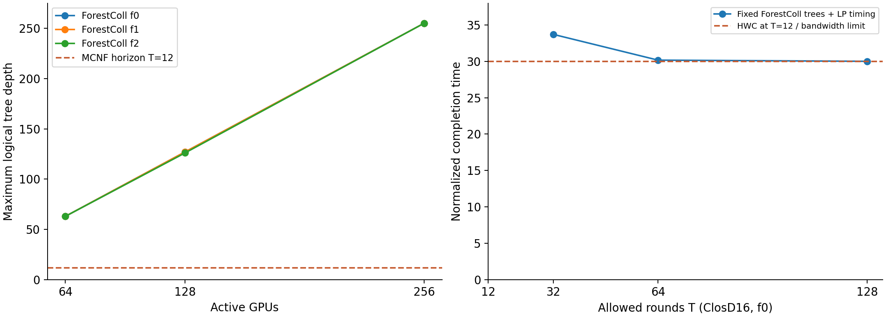

WH1234 的 ClosD + UBD + HPN 共27例对比见 [合并报告](results/wh1234-comparison-v2/comparison.html)、[CSV](results/wh1234-comparison-v2/comparison.csv) 和 [JSON](results/wh1234-comparison-v2/comparison.json)。每例并列 B∞、T=2D/4D 的线性 objective、求解状态和本轮逐阶段/整例计算时间，以及 MCNF main 的历史 T12 worker 与紧凑 LP 调用时间。未完成的项保留空值。原来的本机18行结果保留在[深度与带宽报告](depth_bandwidth.md)。

默认端到端报告口径固定为**每卡0.25 MB（十进制250000 bytes）、单位链路400 Gbps、每活跃步0.1 μs启动开销**，保留拓扑容量比例。`build_comparison_report.py`中的`REPORT_DEFAULTS`统一驱动换算、图注和JSON元数据；后续报告沿用该默认值，专项覆盖必须明确列出，不能覆盖默认参考结果。M=N，因此 `time_us = objective * 5 / N + 0.1 * count(A_t > 0)`；从实际导出方案读取活跃步，空轮不收费，不把T直接当活跃步。

[端到端时间图](results/wh1234-comparison-v2/end_to_end.png)隐藏2D，保留其原始结果及表格；端到端通信时间的纵轴使用从零开始的线性坐标，算法计算耗时的纵轴使用log坐标（底数10）。B∞仅画带宽参考项。我们的曲线使用归档T12方案，红叉保留未过原空间1e-4门槛的数值。参数换算不重新优化调度，也不是硬件实测。

`main_runtime_reference.json`冻结27个main历史T12的A向量、源哈希及HPN的50倍单位换算；ClosD的A从WH1234原始solution.npz提取，大z不拉回。生成记录在本轮报告的`meta/`。ForestColl的4D活跃步从所选`wave_plan.json.gz`或`lp_plan.json.gz`读取并核对哈希及目标；缺少方案文件时端到端时间保留空值。`main compact`指全模式恒定流紧凑LP的带宽下界，表中记录建模+求解+提取耗时，不能作端到端通信曲线。

## WH1234 重跑与计时

`export_mcnf_inputs.py` 从当前 MCNF checkout 的 canonical topology factory 导出27份物理图，并冻结配置、故障映射、源码和参考结果哈希。HPN 使用单向容量4/1；旧 vendor 快照及上游三阶段 Java 算法不变。

```sh
conda run -n math python -B benchmarks/export_mcnf_inputs.py --mcnf-root ../MCNF_tree
conda run -n math python -B benchmarks/setup_java.py
conda run -n math python -u -B benchmarks/run_matrix.py --label new-wh1234 --java-timeout 7200
conda run -n math python -B benchmarks/check_clos.py
conda run -n math python -B benchmarks/check_matrix.py
conda run -n math python -B benchmarks/build_wh1234_report.py --label new-wh1234
```

在 WH1234 的独立目录、conda math 和 JDK21+ 下运行，设置 `OMP_NUM_THREADS=4 OPENBLAS_NUM_THREADS=1 MKL_NUM_THREADS=1`。队列串行运行，每个 Java 进程最多4个并行任务、4GiB堆；逐例7200秒，外层另加300秒守卫。已有输出目录不覆盖；失败尝试留在原位置。单跑 HPN 可用 `clos_benchmark.py --inputs benchmarks/current_inputs.json --network hpn --n 64 --failure 1 --label new-hpn --backend java`。

`search_sec/split_sec/branch_sec` 是 Java 三阶段计时，`java_wall_sec` 还包含 JVM 启动及读写；`python_bound_check_sec` 是独立带宽交叉检查。`case_wall_sec` 包括加载、合成、映射与校验，`process_wall_sec` 另包含 Python 导入等进程开销；原始结果中的 `wall_sec` 对应报告的 `case_wall_sec`。报告保留 MCNF 历史 worker/compact 调用时间及其不同范围，不据此计算求解加速比。缺失时间保持空值。详细环境、JDK包哈希和启动脚本保存在本轮 `meta/`。

下文保留第一轮 ClosD 实验记录。

## 固定森林的有限轮调度与导出

`fixed_schedule.py` 读取已有 case 的 `input.json`、`trees.json` 和 `result.json`，固定全部树、每根分片总量及每次GPU间传输的物理路径。输入 `--time-steps T` 是逻辑轮数上限，不是每轮固定持续时间；每轮持续时间按所有共享物理边的总负载决定，目标为其和（与当前 MCNF 的 M=N、beta=1、alpha=0 一致）。不同树、分片、归约及广播允许同轮重叠，接收到的数据下一轮才能继续传递。固定成对分片的深度 D 树至少需要 2D 轮；不足时明确报不可行，不能删树或重分配分片。

默认矩阵为原27例各跑 `12 2D 4D`：T12是严格相同轮数的比较；2D/4D显示固定森林的流水敏感性，单独标明历史MCNF仍为T12，不计算跨T胜负。所有行均保留原空间1e-4验收标志。

后续结果报告统一同时列出 `B∞`、`objective(T=2D)` 和 `objective(T=4D)`，并给出实际 D、2D、4D 数值。D 为本例固定森林中单阶段 GPU 逻辑树的最大深度，交换机不另计层数；B∞ 为固定树、分片比例和物理路径下，所有物理有向边的归约与广播合计负载/容量的最大值。有限 T 的线性 objective 为各轮持续时间之和，沿用相同数据量和容量口径。每项保留求解状态、可行性校验及各阶段计算时间；仅有 wave 方案时标为可行上界，LP 未运行/超时/失败时明确记录，不能写成已求得 LP 最优值。T12 可作为额外历史参考，不能代替这三项。

论文没有推荐这个MCNF全局轮数T；[§2和§5.5](https://www.usenix.org/system/files/nsdi26-zhao-liangyu.pdf#page=3)采用tree-flow模型，k是每根树数。[§6图10–14](https://www.usenix.org/system/files/nsdi26-zhao-liangyu.pdf#page=10)分别展示GPU实测通信带宽、训练迭代时间，以及方案生成耗时/理论带宽。这里的T12/2D/4D是固定森林的跨模型诊断，不是论文原生实验参数。

```sh
conda run -n math python -B benchmarks/check_fixed_schedule.py
# 在WH1234运行原生求解器小图检查：
conda run -n math python -B benchmarks/check_fixed_schedule.py --solve
conda run -n math python -u -B benchmarks/run_schedule_matrix.py \
  --source benchmarks/results/wh1234-issue272-v1 --label new-fixed-schedule \
  --horizons 12 2D 4D --max-variables 2000000 --solve-limit 600
# 单例，输出必须使用新目录：
conda run -n math python -B benchmarks/fixed_schedule.py \
  benchmarks/results/wh1234-issue272-v1/hpn64_f0 \
  --out benchmarks/results/new-single/hpn64_f0_t100 --time-steps 100
```

队列读取已通过校验的森林；未完成的原case最多等6小时，不重复构树。每次独立进程，LP最多4线程、600秒、16GB软内存限制；外层最多再留600秒给建模/校验/导出，超时只终止本例进程组。模型变量数在构造前预估，超过200万时保留可行wave方案并标记 `skipped_size_guard`。wave按相邻轮启动包，保证每个分片在反向归约后沿原树广播。适合内存规模的LP复用原样冻结的canonical node-arc模型，仅优化时序；每个task/根只放一对树并固定其权重，避免不同树之间交换分片身份，也避免canonical按父节点去重时丢失不同物理路线。

导出的 `wave_plan.json.gz` / `lp_plan.json.gz` 是自包含、可重放的通信方案：

- `graph`保留物理GPU编号（包含坏卡后的空洞）、有向边及容量。
- `shards`指定根、原树编号、分片重数、数据区间起点和大小。数据按排序后的活动根分成N个单位区间，每个GPU都持有这份长度N的原始输入；归约运算采用逐元素求和。
- 每条`operations`给出发送/接收GPU、固定物理路径、归约或广播阶段，以及同一数据区间必须先完成的操作ID。`reduce`表示发送本GPU及其已收到的子树贡献，并在接收端归约；交换机只转发。
- wave循环的第p包（0≤p<repeat）在`first_round+p`轮发送，数据区间为`[data_start+p*amount_per_packet, data_start+(p+1)*amount_per_packet)`。依赖指同一p包，必须在本轮之前完成。压缩循环不会省略任何传输。
- LP的`segments`逐条记录`[round, lo, hi]`，lo/hi相对本分片起点，按FIFO顺序发送。`durations`给出各轮时长；第t轮起点为此前时长的前缀和，同轮传输按`amount/duration`的恒定流速执行。各物理边上的流速总和不超过该边容量。

每份实际写盘后的导出都重新读取并校验分片总量、原树/路径、FIFO数据可用性、每轮物理容量及目标；小图还映射回canonical z并通过原模型校验。`wave_solution.npz`、`lp_solution.npz`和`solver.log`保留在服务器。此格式是数学通信计划，尚未编译成MSCCL/NCCL硬件程序。

`result.json`分别记录输入校验、wave生成/校验/导出、canonical模型构造、canonical校验、求解器调用/内部求解、LP向量保存与校验、LP导出与校验、整例耗时；队列另记包含Python导入的进程耗时。原始森林合成时间仍在源case中，不与新增调度时间混合。队列每完成一个时间步实验便更新JSON/CSV/HTML/PNG报告，并在全部结束后生成最终版本。

合并本轮全部27例和 main 历史计时（只读原始结果，不重新求解）：

```sh
conda run -n math python -B benchmarks/build_comparison_report.py \
  --source benchmarks/results/wh1234-issue272-v1 \
  --schedule benchmarks/results/wh1234-schedule-v1 \
  --out benchmarks/results/wh1234-comparison-v2
conda run -n math python -B benchmarks/check_comparison_report.py
```

每个 T 的总计算时间为一次森林合成进程秒加该 T 的调度进程秒；两个 T 的总时间不能相加，否则重复计算合成。main T12 worker 秒与 compact 调用秒分别保留，compact 调用已包含建模，嵌套阶段不重复相加。耗时比只描述本轮与历史记录；候选树、T、后端及计时范围的区别保留在报告中。WH1234 的有限报告更新任务随这两个队列读取进展并生成合并报告，已有数值计算进程不变。

# ForestColl / MCNF ClosD 首批比较

已完成 16 卡小规模验证，以及标准 ClosD 64/128/256 × 坏 0/1/2 卡共 9 行 ForestColl 完整树生成与物理容量校验。全部修改和结果在本 fork 内；原 MCNF_tree 无修改。上游三阶段算法源码未修改。

上游：<https://github.com/liangyuRain/ForestColl>，revision `d7bd6a94e443e218aa26f319cbe22c70fe16921f`。
MCNF 代码快照 revision `91717ac39bc043fac7490e13beeb082b9cc82fc9`，12 个原样复制的 Python 文件及逐文件 SHA256 见 `vendor/manifest.json`。只新增隔离包入口。

## 比较口径

- 标准输入直接取归档中的 network/task/comm/modeling 字段；失败 ID 为 64:[13,2]、128:[26,5]、256:[52,11]。启用备用 GPU，保持活动卡数不变；带宽均为 1。
- 任务 data_volume=1 在 canonical generator 中扩成 M=N。ForestColl 每根 k=1，每棵树广播量 M/(Nk)=1；AllGather 带宽时间 U/k，RS+AG 两阶段带宽时间 2U/k。
- ForestColl 原生没有 T 参数。`fixed_K` 控制每根树数，不控制深度。代码 `convertToRuntime` 返回 U/(Nk)，乘 M 得带宽模型的时间；未加入树深、启动延迟或有限分块的流水线填充/排空时间。
- `forest_t12` 固定原树和原权重，在复制的 canonical MCNF 模型中检查可行性。`pruned_t12` 才是本项目的真实截断规则：剔除 depth>T 的完整候选树，并让 LP 重优化剩余树权重。这是 ForestColl 候选树 + MCNF 混合诊断，不能称为 ForestColl 原算法结果。
- 单向深度≤T 只是初筛。AllReduce 还要在同一 T 内完成 reduce 与 broadcast 的依赖。ClosD64/f0 剩一棵深度 12 的树，但两阶段仍不可行；其余 8 个标准 case 的所有候选树都被剔除。
- 所有树按 GPU 间逻辑发送计算深度，交换机不另算计算节点。检查了根、全部参与者、路径连续性、真实物理边、每根 chunk 总量、边容量和与 MCNF 唯一物理路由的一致性。
- MCNF 标准大规模结果来自现有 main-only 归档，没有重新跑 GPU。128/f2、256/f1、256/f2 不满足 1e-4 原空间门槛；保留标识，不能当作可靠最优值。64 与128其余行约等于 ForestColl 带宽值；256/f0 为518.045，相比理想带宽值510约高1.58%，但这不是可实现的 ForestColl T12 加速比。
- ForestColl 合成在本机 Apple M4 / Java25 / common pool parallelism=4 / Xmx4g 上执行。合成秒包含 JVM 启动与映射回物理路径；MCNF 历史求解在另一台 CPU/GPU 机器上，不能据此宣称同机求解加速。时间为单次观测，部分小规模诊断与大规模合成有重叠。
- 没有进行 NCCL/RCCL GPU 执行或真实网络测试；这里比较的是合成和数学调度。

## 标准矩阵

| GPU | 坏卡 | ForestColl 带宽时间 | MCNF 历史 T12 | 历史原空间合格 | 树深 min–max | 合成秒 | T12 剩余树 | 剔除后重优化 |
|---:|---:|---:|---:|:---:|:---:|---:|---:|:---|
| 64 | 0 | 126 | 125.999992 | 是 | 12–63 | 1.867 | 1 | infeasible |
| 64 | 1 | 126 | 126.000025 | 是 | 13–63 | 1.320 | 0 | no_tree_after_depth_filter |
| 64 | 2 | 126 | 125.999993 | 是 | 17–63 | 1.691 | 0 | no_tree_after_depth_filter |
| 128 | 0 | 254 | 254.000004 | 是 | 38–127 | 7.300 | 0 | no_tree_after_depth_filter |
| 128 | 1 | 254 | 253.999874 | 是 | 38–127 | 7.541 | 0 | no_tree_after_depth_filter |
| 128 | 2 | 254 | 254.021537 | 否 | 33–126 | 7.886 | 0 | no_tree_after_depth_filter |
| 256 | 0 | 510 | 518.045259 | 是 | 88–255 | 64.812 | 0 | no_tree_after_depth_filter |
| 256 | 1 | 510 | 517.780204 | 否 | 89–255 | 82.361 | 0 | no_tree_after_depth_filter |
| 256 | 2 | 510 | 518.237883 | 否 | 87–255 | 71.105 | 0 | no_tree_after_depth_filter |

## 有限轮数证据

ClosD16 的 HWC f0/f1/f2 本机复跑均在 T=12 得到约30，原空间验证通过。
对于 Java 原版生成的 ClosD16/f0 树，固定其权重、只优化时间安排，T=32/64/128 的完成时间分别为 33.693504 / 30.161532 / 30.002436，均通过原空间检查。稳态带宽值为30。
这说明在这个已测例子中，充分增加轮数可以逼近带宽值，而低轮数下 HWC 已达到它。
小规模按截断规则重优化：f0/f2 不可行；f1 可行但目标224。此结果针对保存的这组树，不是对所有 ForestColl 树选择的下界。



## 对树深的解释

论文 §3 明确选择优先吞吐；附录 E.3 承认低树高有利于低延迟及接近最优吞吐，并引用最小高度边不相交生成树构造的 NP-complete 结果。依据：<https://www.usenix.org/system/files/nsdi26-zhao-liangyu.pdf#page=25>。
准确的比较主张是：其吞吐最优保证不包含树高或有限轮次完成时间保证。本次生成树确实出现近线性深度。不能把最小树高的困难性扩大为“任何多项式算法都无法控制树高”，也不能把本模型的 T12 不可行写成真实硬件上无法执行。

## 重跑

Python 使用 conda math；Java 使用支持源码 API 的 JDK21+（本次JDK25）。脚本拒绝覆盖已有结果目录。

```sh
conda run -n math python -B benchmarks/setup_java.py
conda run -n math python -B benchmarks/clos_benchmark.py --n 16 --failure 0 --label new-smoke --backend java --finite --baseline
conda run -n math python -B benchmarks/clos_benchmark.py --n 64 --failure 1 --label new-standard --backend java --finite
conda run -n math python -B benchmarks/check_clos.py
```

`finite_sweep.py <case_dir> --horizons 32 64 128` 保持 ForestColl 原权重，优化有限步调度。`evaluate_pruned.py` 重放本次12个Java case的 depth≤12 截断并自由优化权重；已有目录不会被覆盖。`build_report.py` 只从本次完成结果重建报告。

原始输入、树、Java阶段输出、日志、求解向量均保存在 `results/`。NPZ 向量以及Java依赖和构建产物被 Git 忽略；依赖的固定URL和SHA256在 `java_dependencies.json`。Java的集合迭代和并行实现可能改变树的具体选择；每次的原始树及其哈希均保存，不能假定重跑逐字节相同。
