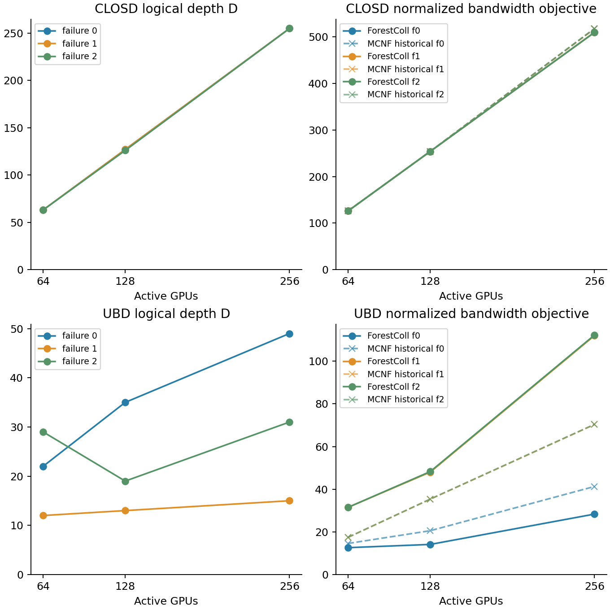

# ForestColl：ClosD / UBD 标准实验的深度与带宽

本轮按用户修订，只记录深度与带宽 objective，不代入论文的 α、β，不运行参数扫描。ClosD 和 UBD 各9行，共18行均保存完整树并通过容量校验。

D 是单阶段逻辑树高；2D 是同一棵树先归约再广播的最长依赖链。逻辑树的一条边可以包含多个交换机物理跳，沿用 MCNF 的 GPU 间通信步定义。

M=N：task.data_volume=1 经标准生成器扩大到N，每个根负责1单位，每个 elementary tree 负责1/k单位；压缩后的树记录chunks/k单位。容量和objective均沿用标准归一化单位。

B∞按归约与广播合并后的逐物理边总负载计算，允许两个阶段流水重叠；不会强制全局阶段屏障。顺序执行的两个阶段objective也单独保留。

后续可用(2D)α+B∞β作为延迟项加拥塞项的估计；这两个独立极限不一定能在同一有限分块调度里同时达到，不能直接标作已验证执行时间。

这次测量的是开源默认的等分片AllGather生成树及其反向组合。论文§5.7明确指出，该组合不保证AllReduce全局最优；论文附录G的专门AllReduce优化LP未在此次适配中实现。

UBD输入复用issue237归档，并显式填写当前标准带宽1/4/4/32/64。固定故障64:[13,2]、128:[26,5]、256:[52,11]均在原rack0；f2按既有替代策略启用rack0和rack1备用卡，不扩容。原标准文档中“两故障位于不同rack”的文字与实际输入不符，本实验以代码和归档的确切映射为准，未修改MCNF仓库。

MCNF结果复用历史T12 main-only归档。UBD原始状态全部为optimal_inaccurate，保留原状态；仅64/f0与64/f1的原空间最大违反≤当前1e-4门槛。其余历史UBD数值仅供观察，不能据此宣称严格胜负。

Java并行实现、JDK25（启用-ea断言）、common pool parallelism=4、Xmx4g。树的具体选择可能随集合遍历和并行运行变化；本次原始树及SHA256均保存。没有真实GPU网络执行，也没有把异机历史求解时间当成同机加速比。

UBD256/f0首轮在900秒时限内未完成，失败尝试保留在ubd-standard-v1；重跑使用独立v2目录，初始3600秒观察时限在不重启Java工作进程的情况下延至5400秒；具体监督记录在deadline_override.json。表中合成时间指最终完成的一次尝试，失败尝试另见JSON中的attempts。

原ForestColl三阶段算法文件及MCNF源仓库均未修改。适配、报告、完整输出只在ForestColl fork内。

| 网络 | GPU | 坏卡 | D | 2D | B∞ | 顺序RS+AG | MCNF历史T12 | 历史≤1e-4 | 树数 | 合成秒 |
|---|---|---|---|---|---|---|---|---|---|---|
| closd | 64 | 0 | 63 | 126 | 126.000000 | 126.000000 | 125.999992 | 是 | 64 | 1.87 |
| closd | 64 | 1 | 63 | 126 | 126.000000 | 126.000000 | 126.000025 | 是 | 64 | 1.32 |
| closd | 64 | 2 | 63 | 126 | 126.000000 | 126.000000 | 125.999993 | 是 | 64 | 1.69 |
| closd | 128 | 0 | 127 | 254 | 254.000000 | 254.000000 | 254.000004 | 是 | 128 | 7.30 |
| closd | 128 | 1 | 127 | 254 | 254.000000 | 254.000000 | 253.999874 | 是 | 128 | 7.54 |
| closd | 128 | 2 | 126 | 252 | 254.000000 | 254.000000 | 254.021537 | 否 | 128 | 7.89 |
| closd | 256 | 0 | 255 | 510 | 510.000000 | 510.000000 | 518.045259 | 是 | 256 | 64.81 |
| closd | 256 | 1 | 255 | 510 | 510.000000 | 510.000000 | 517.780204 | 否 | 256 | 82.36 |
| closd | 256 | 2 | 255 | 510 | 510.000000 | 510.000000 | 518.237883 | 否 | 256 | 71.11 |
| ubd | 64 | 0 | 22 | 44 | 12.600000 | 12.600000 | 14.571428 | 是 | 274 | 5.05 |
| ubd | 64 | 1 | 12 | 24 | 31.500000 | 31.500000 | 17.409330 | 是 | 112 | 1.73 |
| ubd | 64 | 2 | 29 | 58 | 31.500000 | 31.500000 | 17.450297 | 否 | 108 | 1.32 |
| ubd | 128 | 0 | 35 | 70 | 14.111111 | 14.111111 | 20.545356 | 否 | 954 | 411.41 |
| ubd | 128 | 1 | 13 | 26 | 48.000000 | 63.500000 | 35.313035 | 否 | 137 | 22.85 |
| ubd | 128 | 2 | 19 | 38 | 48.250000 | 63.500000 | 35.362563 | 否 | 136 | 22.87 |
| ubd | 256 | 0 | 49 | 98 | 28.333333 | 28.333333 | 41.272754 | 否 | 1171 | 3496.33 |
| ubd | 256 | 1 | 15 | 30 | 112.000000 | 127.500000 | 70.323143 | 否 | 396 | 182.67 |
| ubd | 256 | 2 | 31 | 62 | 112.250000 | 127.500000 | 70.403884 | 否 | 371 | 298.56 |

带宽计算：令 L_e 为所有保存的 out-tree 在物理有向边e上的总负载，则 B∞=max_e (L_e+L_reverse(e))/W_e。归约用反向路径，广播用原路径。

数据：[CSV](depth_bandwidth.csv)、[JSON与逐边瓶颈](depth_bandwidth.json)。上轮ClosD有限T诊断仍在[旧报告](report.html)。

重跑：`conda run -n math python -B benchmarks/clos_benchmark.py --network ubd --n 64 --failure 0 --label new-ubd --backend java`。结果目录不得已存在。验证：`conda run -n math python -B benchmarks/check_clos.py`。生成本报告：`conda run -n math python -B benchmarks/build_depth_report.py`。

论文：[§5.7](https://www.usenix.org/system/files/nsdi26-zhao-liangyu.pdf#page=9)。
