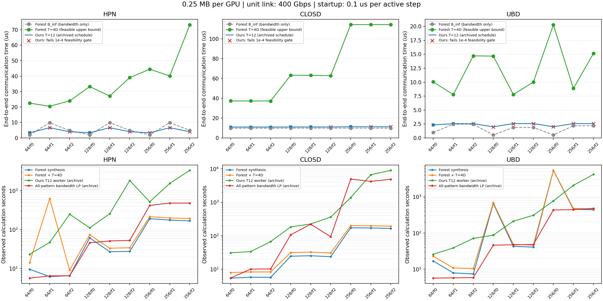

# ForestColl / ours：端到端时间与计算耗时

27例全部列出 · 森林校验 27/27 · 有限T有效值 54/54（LP最优 3 项，其余有效值为可行上界）

端到端通信时间图的纵轴使用从零开始的线性坐标；算法计算耗时图的纵轴使用log坐标（底数10）。缺失项保留空值，B∞仍仅为带宽项。

默认端到端报告口径：每卡0.25 MB（十进制250000 bytes），单位链路400 Gbps，每活跃步启动开销0.1 μs；原始M=N，故时间(μs)=objective×5/N+0.1×活跃步数。活跃步按保存的A_t>0计数，空轮不收费；保留拓扑原有容量比例，例如HPN的4/1对应1600/400 Gbps。

图中隐藏2D，展示ForestColl的4D具体方案与我们的历史T12方案；仅在已有调度上换算，未针对新alpha重新优化。B∞虚线仅含带宽项，不是完整端到端时间。红叉标记main历史结果未通过原空间1e-4门槛，不能当作已验收的可执行方案。

每例并列报告 B∞、T=2D 和 T=4D 的线性 objective；D 是固定森林最大单阶段 GPU 逻辑树深，交换机不另计层数。树、分片比例和物理路径固定；M=N、beta=1、alpha=0，HPN单向容量4/1。

B∞ 是固定森林归约与广播合计物理边负载/容量的最大值。有限T目标是各轮持续时间之和。LP最优与wave可行上界明确分开；规模守卫、超时、未完成保留状态和空值，不能把wave写成LP最优值。

ForestColl合成秒为包含Python/JVM启动、树生成、映射与校验的进程时间；2D/4D新增秒各自包含调度生成、可选LP求解、校验与导出。单个T的总秒=合成秒+该T新增秒；合成仅计一次，两个T的总秒不能相加。

main T12秒是历史WH1234 worker总时间；main compact是去掉时序约束的全模式恒定流紧凑LP，用于带宽下界，其计算秒为建模+求解+提取调用时间，已包含建模秒，不是通信执行时间。候选树、T、后端和计时范围不同，耗时比只描述这批历史记录，不表示同算法同口径求解加速比。

main记录仍保留T12原空间1e-4验收状态。HPN旧200/50结果目标乘50对齐4/1，历史计算耗时不缩放。旧T12 objective是附加参考，不与2D/4D作同T胜负判断。

main阶段时间可能嵌套，不能逐项全部相加；缺失阶段保持空值。失败/超时的实际进程时间仍计入。所有时间为本轮或历史单次测量，单位秒；详细阶段计时、原始LP状态及来源在JSON/CSV。

## 端到端时间（μs）

| 案例 | Forest B∞纯带宽μs | Forest T=4D | Forest活跃步 | Forest端到端μs | 我们T12活跃步 | 我们T12端到端μs | 我们历史≤1e-4 |
|---|---|---|---|---|---|---|---|
| closd64_f0 | 9.84375 | 252 | 252 | 37.4035 | 12 | 11.0437 | 是 |
| closd64_f1 | 9.84375 | 252 | 252 | 37.409 | 12 | 11.0438 | 是 |
| closd64_f2 | 9.84375 | 252 | 252 | 37.3721 | 12 | 11.0437 | 是 |
| closd128_f0 | 9.92188 | 508 | 508 | 63.347 | 12 | 11.1219 | 是 |
| closd128_f1 | 9.92188 | 508 | 508 | 63.2589 | 12 | 11.1219 | 是 |
| closd128_f2 | 9.92188 | 504 | 504 | 62.9124 | 12 | 11.1227 | 否 |
| closd256_f0 | 9.96094 | 1020 | 1020 | 114.504 | 12 | 11.3181 | 是 |
| closd256_f1 | 9.96094 | 1020 | 1020 | 114.495 | 12 | 11.3129 | 否 |
| closd256_f2 | 9.96094 | 1020 | 1020 | 114.479 | 12 | 11.3218 | 否 |
| hpn64_f0 | 1.96875 | 200 | 200 | 22.5473 | 12 | 3.3875 | 是 |
| hpn64_f1 | 9.84375 | 88 | 88 | 20.5135 | 12 | 6.64665 | 否 |
| hpn64_f2 | 4.84375 | 180 | 180 | 24.004 | 12 | 4.0233 | 否 |
| hpn128_f0 | 1.98438 | 308 | 308 | 33.2269 | 12 | 3.3875 | 是 |
| hpn128_f1 | 9.92188 | 152 | 152 | 27.1394 | 12 | 6.65064 | 否 |
| hpn128_f2 | 4.92188 | 328 | 328 | 39.0495 | 12 | 4.04398 | 否 |
| hpn256_f0 | 1.99219 | 416 | 416 | 44.4643 | 12 | 3.3875 | 否 |
| hpn256_f1 | 9.96094 | 280 | 280 | 40.1184 | 12 | 6.65265 | 否 |
| hpn256_f2 | 4.96094 | 668 | 668 | 73.1383 | 12 | 4.0544 | 否 |
| ubd64_f0 | 0.984375 | 88 | 88 | 10.0513 | 12 | 2.33839 | 是 |
| ubd64_f1 | 2.46094 | 48 | 48 | 7.77383 | 12 | 2.5601 | 是 |
| ubd64_f2 | 2.46094 | 116 | 116 | 14.7134 | 12 | 2.5633 | 否 |
| ubd128_f0 | 0.551215 | 140 | 140 | 14.6635 | 12 | 2.00255 | 否 |
| ubd128_f1 | 1.875 | 52 | 52 | 7.78934 | 12 | 2.57942 | 否 |
| ubd128_f2 | 1.88477 | 76 | 76 | 10.0115 | 12 | 2.58135 | 否 |
| ubd256_f0 | 0.553385 | 196 | 196 | 20.2575 | 12 | 2.00611 | 否 |
| ubd256_f1 | 2.1875 | 60 | 60 | 8.88027 | 12 | 2.5735 | 否 |
| ubd256_f2 | 2.19238 | 124 | 124 | 15.1254 | 12 | 2.57508 | 否 |

## 通信目标

| 案例 | D | B∞ | T=2D | objective(2D) | 2D值性质 | 2D LP状态 | T=4D | objective(4D) | 4D值性质 | 4D LP状态 | 2D运行状态 | 4D运行状态 | main历史T12 | 历史≤1e-4 |
|---|---|---|---|---|---|---|---|---|---|---|---|---|---|---|
| closd64_f0 | 63 | 126 | 126 | 1525 | wave可行上界 | skipped_size_guard | 252 | 156.205 | wave可行上界 | skipped_size_guard | wave_feasible | wave_feasible | 126 | 是 |
| closd64_f1 | 63 | 126 | 126 | 1731 | wave可行上界 | skipped_size_guard | 252 | 156.276 | wave可行上界 | skipped_size_guard | wave_feasible | wave_feasible | 126 | 是 |
| closd64_f2 | 63 | 126 | 126 | 1688 | wave可行上界 | skipped_size_guard | 252 | 155.803 | wave可行上界 | skipped_size_guard | wave_feasible | wave_feasible | 126 | 是 |
| closd128_f0 | 127 | 254 | 254 | 7194 | wave可行上界 | skipped_size_guard | 508 | 321.204 | wave可行上界 | skipped_size_guard | wave_feasible | wave_feasible | 254 | 是 |
| closd128_f1 | 127 | 254 | 254 | 7343 | wave可行上界 | skipped_size_guard | 508 | 318.949 | wave可行上界 | skipped_size_guard | wave_feasible | wave_feasible | 254 | 是 |
| closd128_f2 | 126 | 254 | 252 | 7179 | wave可行上界 | skipped_size_guard | 504 | 320.316 | wave可行上界 | skipped_size_guard | wave_feasible | wave_feasible | 254.022 | 否 |
| closd256_f0 | 255 | 510 | 510 | 26677 | wave可行上界 | skipped_size_guard | 1020 | 640.19 | wave可行上界 | skipped_size_guard | wave_feasible | wave_feasible | 518.045 | 是 |
| closd256_f1 | 255 | 510 | 510 | 26688 | wave可行上界 | skipped_size_guard | 1020 | 639.765 | wave可行上界 | skipped_size_guard | wave_feasible | wave_feasible | 517.78 | 否 |
| closd256_f2 | 255 | 510 | 510 | 26868 | wave可行上界 | skipped_size_guard | 1020 | 638.926 | wave可行上界 | skipped_size_guard | wave_feasible | wave_feasible | 518.238 | 否 |
| hpn64_f0 | 50 | 25.2 | 100 | 224.4 | wave可行上界 | skipped_size_guard | 200 | 32.6054 | wave可行上界 | skipped_size_guard | wave_feasible | wave_feasible | 28 | 是 |
| hpn64_f1 | 22 | 126 | 44 | 163.83 | LP最优 | optimal | 88 | 149.933 | wave可行上界 | user_limit | lp_feasible | wave_feasible | 69.7171 | 否 |
| hpn64_f2 | 45 | 62 | 90 | 97.5102 | LP最优 | optimal | 180 | 76.8516 | wave可行上界 | skipped_size_guard | lp_feasible | wave_feasible | 36.1383 | 否 |
| hpn128_f0 | 77 | 50.8 | 154 | 481.9 | wave可行上界 | skipped_size_guard | 308 | 62.1287 | wave可行上界 | skipped_size_guard | wave_feasible | wave_feasible | 56 | 是 |
| hpn128_f1 | 38 | 254 | 76 | 2367 | wave可行上界 | skipped_size_guard | 152 | 305.649 | wave可行上界 | skipped_size_guard | wave_feasible | wave_feasible | 139.536 | 否 |
| hpn128_f2 | 82 | 126 | 164 | 1807.25 | wave可行上界 | skipped_size_guard | 328 | 159.988 | wave可行上界 | skipped_size_guard | wave_feasible | wave_feasible | 72.8059 | 否 |
| hpn256_f0 | 104 | 102 | 208 | 1820.5 | wave可行上界 | skipped_size_guard | 416 | 146.652 | wave可行上界 | skipped_size_guard | wave_feasible | wave_feasible | 112 | 否 |
| hpn256_f1 | 70 | 510 | 140 | 9107 | wave可行上界 | skipped_size_guard | 280 | 620.461 | wave可行上界 | skipped_size_guard | wave_feasible | wave_feasible | 279.176 | 否 |
| hpn256_f2 | 167 | 254 | 334 | 6937 | wave可行上界 | skipped_size_guard | 668 | 324.519 | wave可行上界 | skipped_size_guard | wave_feasible | wave_feasible | 146.145 | 否 |
| ubd64_f0 | 22 | 12.6 | 44 | 85.425 | wave可行上界 | skipped_size_guard | 88 | 16.0161 | wave可行上界 | skipped_size_guard | wave_feasible | wave_feasible | 14.5714 | 是 |
| ubd64_f1 | 12 | 31.5 | 24 | 41.25 | LP最优 | optimal | 48 | 38.065 | wave可行上界 | skipped_size_guard | lp_feasible | wave_feasible | 17.4093 | 是 |
| ubd64_f2 | 29 | 31.5 | 58 | 220.188 | wave可行上界 | skipped_size_guard | 116 | 39.8517 | wave可行上界 | skipped_size_guard | wave_feasible | wave_feasible | 17.4503 | 否 |
| ubd128_f0 | 35 | 14.1111 | 70 | 102.833 | wave可行上界 | skipped_size_guard | 140 | 16.9847 | wave可行上界 | skipped_size_guard | wave_feasible | wave_feasible | 20.5454 | 否 |
| ubd128_f1 | 13 | 48 | 26 | 322.5 | wave可行上界 | skipped_size_guard | 52 | 66.287 | wave可行上界 | skipped_size_guard | wave_feasible | wave_feasible | 35.313 | 否 |
| ubd128_f2 | 19 | 48.25 | 38 | 376.125 | wave可行上界 | skipped_size_guard | 76 | 61.734 | wave可行上界 | skipped_size_guard | wave_feasible | wave_feasible | 35.3626 | 否 |
| ubd256_f0 | 49 | 28.3333 | 98 | 200.833 | wave可行上界 | skipped_size_guard | 196 | 33.6633 | wave可行上界 | skipped_size_guard | wave_feasible | wave_feasible | 41.2728 | 否 |
| ubd256_f1 | 15 | 112 | 30 | 749.438 | wave可行上界 | skipped_size_guard | 60 | 147.47 | wave可行上界 | skipped_size_guard | wave_feasible | wave_feasible | 70.3231 | 否 |
| ubd256_f2 | 31 | 112.25 | 62 | 983.812 | wave可行上界 | skipped_size_guard | 124 | 139.539 | wave可行上界 | skipped_size_guard | wave_feasible | wave_feasible | 70.4039 | 否 |

## 计算耗时（秒）

| 案例 | Forest合成秒 | 2D新增秒 | 合成+2D秒 | 4D新增秒 | 合成+4D秒 | main T12 worker秒 | main compact调用秒 | 合成/main比 | 合成+2D/main比 | 合成+4D/main比 |
|---|---|---|---|---|---|---|---|---|---|---|
| closd64_f0 | 5.38527 | 2.47742 | 7.86269 | 2.52923 | 7.9145 | 31.0173 | 5.4358 | 0.173621 | 0.253493 | 0.255164 |
| closd64_f1 | 5.73785 | 2.52896 | 8.26682 | 2.5296 | 8.26745 | 33.5554 | 10.0208 | 0.170996 | 0.246363 | 0.246382 |
| closd64_f2 | 5.68754 | 2.47757 | 8.16511 | 2.57982 | 8.26736 | 66.8653 | 10.1717 | 0.0850596 | 0.122113 | 0.123642 |
| closd128_f0 | 24.4199 | 6.44291 | 30.8628 | 6.99573 | 31.4157 | 184.16 | 106.332 | 0.132602 | 0.167587 | 0.170589 |
| closd128_f1 | 25.2082 | 6.4432 | 31.6514 | 7.14544 | 32.3536 | 224.888 | 221.49 | 0.112092 | 0.140743 | 0.143866 |
| closd128_f2 | 23.6425 | 6.39341 | 30.0359 | 7.04436 | 30.6869 | 362.719 | 93.6982 | 0.0651813 | 0.0828076 | 0.0846023 |
| closd256_f0 | 172.568 | 25.7638 | 198.332 | 27.7668 | 200.335 | 1387.14 | 4938.22 | 0.124406 | 0.142979 | 0.144423 |
| closd256_f1 | 171.236 | 25.0553 | 196.292 | 27.9199 | 199.156 | 6696.59 | 4240.06 | 0.0255707 | 0.0293122 | 0.02974 |
| closd256_f2 | 165.833 | 25.7145 | 191.548 | 27.6696 | 193.503 | 9074.06 | 4897.57 | 0.0182756 | 0.0211094 | 0.0213249 |
| hpn64_f0 | 9.54619 | 3.8335 | 13.3797 | 4.68519 | 14.2314 | 23.154 | 5.65075 | 0.412291 | 0.577856 | 0.61464 |
| hpn64_f1 | 6.18788 | 144.998 | 151.186 | 614.753 | 620.941 | 46.8581 | 6.45766 | 0.132056 | 3.22647 | 13.2515 |
| hpn64_f2 | 6.53602 | 345.951 | 352.487 | 2.52731 | 9.06334 | 247.954 | 6.52843 | 0.0263599 | 1.42158 | 0.0365525 |
| hpn128_f0 | 61.4707 | 11.6097 | 73.0804 | 12.3622 | 73.8328 | 110.851 | 45.6828 | 0.554534 | 0.659266 | 0.666054 |
| hpn128_f1 | 27.0048 | 5.93919 | 32.944 | 6.24223 | 33.247 | 254.745 | 51.0942 | 0.106007 | 0.129322 | 0.130511 |
| hpn128_f2 | 27.4517 | 6.24087 | 33.6926 | 6.69492 | 34.1467 | 1825.05 | 52.7306 | 0.0150416 | 0.0184611 | 0.0187099 |
| hpn256_f0 | 190.752 | 21.8459 | 212.598 | 24.4089 | 215.161 | 518.011 | 419.128 | 0.368239 | 0.410412 | 0.415359 |
| hpn256_f1 | 175.892 | 22.6001 | 198.492 | 23.0531 | 198.945 | 1546.25 | 480.724 | 0.113754 | 0.12837 | 0.128663 |
| hpn256_f2 | 167.84 | 23.8502 | 191.691 | 25.7619 | 193.602 | 3341.28 | 479.08 | 0.0502323 | 0.0573704 | 0.0579425 |
| ubd64_f0 | 16.825 | 5.94129 | 22.7663 | 5.98953 | 22.8145 | 25.8968 | 5.65049 | 0.649694 | 0.879115 | 0.880978 |
| ubd64_f1 | 7.8958 | 103.143 | 111.038 | 2.92905 | 10.8248 | 38.6434 | 5.74153 | 0.204325 | 2.87341 | 0.280121 |
| ubd64_f2 | 7.39015 | 3.03122 | 10.4214 | 3.02974 | 10.4199 | 70.8935 | 5.8556 | 0.104243 | 0.147 | 0.146979 |
| ubd128_f0 | 648.999 | 34.7915 | 683.791 | 35.8426 | 684.842 | 87.3109 | 46.0356 | 7.4332 | 7.83168 | 7.84372 |
| ubd128_f1 | 43.0777 | 5.48975 | 48.5674 | 5.48956 | 48.5672 | 212.217 | 47.2572 | 0.202989 | 0.228858 | 0.228857 |
| ubd128_f2 | 40.6714 | 5.48937 | 46.1608 | 5.53935 | 46.2108 | 309.043 | 48.0829 | 0.131605 | 0.149367 | 0.149529 |
| ubd256_f0 | 5320.07 | 87.9466 | 5408.02 | 85.3431 | 5405.41 | 770.018 | 432.001 | 6.90902 | 7.02324 | 7.01985 |
| ubd256_f1 | 452.845 | 24.7994 | 477.645 | 23.7542 | 476.599 | 2076.78 | 443.945 | 0.218052 | 0.229993 | 0.22949 |
| ubd256_f2 | 438.652 | 22.1965 | 460.848 | 22.4501 | 461.102 | 4165.08 | 479.082 | 0.105316 | 0.110646 | 0.110707 |

